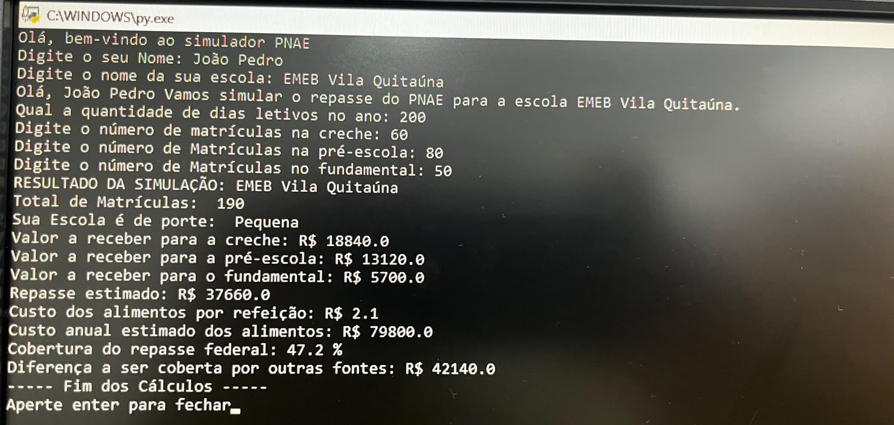
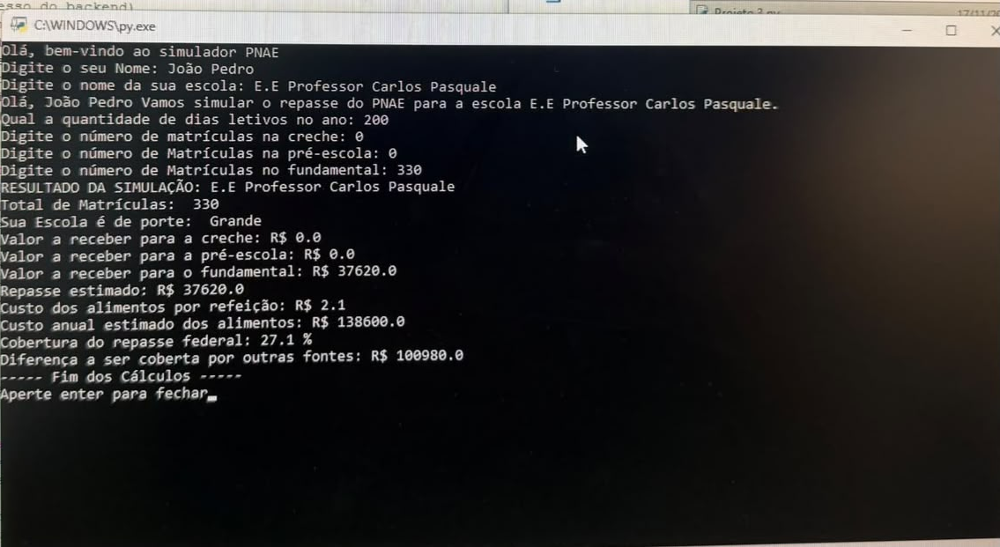

# Projeto 5: Simulador de Repasse do PNAE em Python

## Objetivo

O simulador calcula quanto uma escola pública recebe por ano do Programa Nacional de Alimentação Escolar (PNAE), a partir dos dias letivos e do número de alunos de creche, pré-escola e ensino fundamental, usando os valores per capita fixados pelo FNDE para 2026. Ele também classifica o porte da escola e compara o repasse federal com o custo estimado dos alimentos, mostrando que parte desse custo a União cobre e quanto precisa vir de outras fontes, como o estado ou o município.

## Como usar

É preciso ter o Python 3 instalado. O programa não usa nenhuma biblioteca extra. Com o arquivo `simulador_pnae.py` baixado, abra o terminal na pasta onde ele está e rode:

```
python simulador_pnae.py
```

(No Windows, se o comando `python` não for reconhecido, use `py simulador_pnae.py`.)

O programa pede, nesta ordem: o seu nome, o nome da escola, a quantidade de dias letivos no ano e o número de matrículas na creche, na pré-escola e no ensino fundamental. Nome e escola podem ser escritos livremente. Os demais campos aceitam apenas números inteiros, sem pontos, vírgulas ou espaços; se a escola não tiver alunos em alguma etapa, digite 0. Se for digitado algo que não seja um número inteiro, o programa avisa e repete a pergunta.

Ao final, aparecem o total de matrículas, o porte da escola, o repasse de cada etapa e o total, o custo anual estimado dos alimentos, a cobertura do repasse federal em porcentagem e a diferença a ser coberta por outras fontes. Para fechar, basta apertar Enter.

## Prints do resultado

Teste com os dados do Projeto 1 (EMEB Vila Quitaúna: 200 dias letivos, 60 alunos de creche, 80 de pré-escola e 50 de ensino fundamental), que reproduz o repasse anual de R$ 37.660,00 e o porte Pequena:



Simulação com a escola real escolhida, a E.E. Professor Carlos Pasquale:



## Escola simulada

| Informação | Valor |
| --- | --- |
| Nome | Professor Carlos Pasquale (na base: CARLOS PASQUALE PROFESSOR) |
| Código INEP | 35038179 |
| Município / UF | São Paulo / SP |
| Dependência administrativa | Estadual |
| Situação de funcionamento | Em atividade |
| Matrículas de creche | 0 |
| Matrículas de pré-escola | 0 |
| Matrículas de ensino fundamental | 330 (todas nos anos finais) |

**Como os dados foram encontrados.** Usamos os microdados do Censo Escolar da Educação Básica 2024, publicados pelo INEP, especificamente o arquivo `microdados_ed_basica_2024.csv`, que traz uma linha por escola e é separado por ponto e vírgula. Pelo dicionário de dados, identificamos as variáveis de identificação (`NO_ENTIDADE`, `CO_ENTIDADE`, `NO_MUNICIPIO`, `SG_UF`), de dependência administrativa (`TP_DEPENDENCIA`), de situação de funcionamento (`TP_SITUACAO_FUNCIONAMENTO`) e de matrículas por etapa (`QT_MAT_INF_CRE`, `QT_MAT_INF_PRE`, `QT_MAT_FUND`). Buscamos a palavra "PASQUALE" no nome das escolas e encontramos mais de um resultado. Duas escolas públicas em atividade na cidade de São Paulo tinham o nome do professor: uma estadual, no bairro Vila Moraes, e uma municipal (EMEF), no Itaim Paulista. Escolhemos a estadual e a filtramos pelo código INEP 35038179, conferindo que `TP_DEPENDENCIA` = 2 (estadual) e `TP_SITUACAO_FUNCIONAMENTO` = 1 (em atividade).

A escola não tem matrículas de creche nem de pré-escola, porque atende apenas os anos finais do ensino fundamental. Por isso, o simulador recebeu 0 nessas duas etapas.

## Custo dos alimentos

| Informação | Valor |
| --- | --- |
| Custo dos alimentos por refeição adotado | R$ 2,10 |
| Fonte | Secretaria da Educação do Estado de São Paulo (Seduc-SP), anúncio dos valores da alimentação escolar da rede estadual para 2024, noticiado pela Gazeta SP e pelo SBT News |
| Links | https://www.gazetasp.com.br/estado/sp-propoe-aumento-de-ate-40-no-repasse-as-prefeituras-para/ e https://sbtnews.sbt.com.br/noticia/brasil/268064-sp-anuncia-aumento-de-quase-40-no-repasse-as-prefeituras-para-alimentacao-escolar |
| Data da informação | 08/12/2023 (valores válidos para 2024) |

**Por que esse valor.** Para 2024, a Seduc-SP fixou em R$ 1,60 o repasse diário do Estado por aluno do ensino regular, que recebe uma refeição por dia. Somado à parte federal do PNAE da época (R$ 0,50), o total por estudante chega a R$ 2,10 por dia. Escolhemos essa referência porque ela vem da mesma rede da escola simulada (a estadual paulista), trata do mesmo tipo de atendimento (período parcial, uma refeição por dia) e representa o valor que o próprio governo estadual considera necessário para alimentar um aluno.

**Ressalvas.** A comparação com o repasse federal deve ser feita apenas com o custo dos alimentos, porque, pela Lei nº 11.947/2009, o recurso do PNAE só pode ser usado na compra de gêneros alimentícios; merendeiras, gás, equipamentos e cozinhas são pagos por estados e municípios. A referência adotada tem três limitações. Primeiro, o valor se aplica aos 493 municípios que têm convênio com a Seduc-SP para a alimentação escolar, e não à capital, onde fica a escola e onde a própria Secretaria compra os alimentos e gerencia a cozinha. Segundo, nesses municípios as prefeituras usam o repasse para comprar os insumos e também para contratar merendeiras e preparar as refeições; se parte dos R$ 2,10 cobre esses gastos, o custo só dos alimentos seria um pouco menor, e a cobertura real do repasse federal, um pouco maior que a calculada. Terceiro, o valor é de 2024, quando a parte federal ainda era R$ 0,50 (hoje é R$ 0,57), e não considera a inflação dos alimentos desde então, o que puxaria o custo para cima.

## Resultados e reflexão

| Resultado (E.E. Professor Carlos Pasquale, 200 dias letivos) | Valor |
| --- | --- |
| Repasse anual do PNAE | R$ 37.620,00 |
| Porte da escola | Grande |
| Custo anual estimado dos alimentos | R$ 138.600,00 |
| Cobertura do repasse federal | 27,1% |
| Diferença a ser coberta por outras fontes | R$ 100.980,00 |

Como a escola só tem ensino fundamental, a cobertura depende apenas da relação entre o per capita federal de R$ 0,57 e o custo de R$ 2,10 por refeição, independentemente do número de alunos. O ensino fundamental tem o menor per capita entre as três etapas do simulador (contra R$ 0,82 da pré-escola e R$ 1,57 da creche), por isso esta escola representa o cenário em que o repasse federal cobre a menor parte da alimentação.

Na prática, de cada R$ 1,00 gasto com a comida dos alunos da E.E. Professor Carlos Pasquale, a União paga cerca de 27 centavos. Os outros R$ 100.980,00 por ano precisam sair do orçamento do Estado de São Paulo. Se a escola atendesse outras etapas, o quadro seria um pouco diferente. Com o mesmo custo de R$ 2,10 por refeição, o repasse federal cobriria cerca de 75% dos alimentos de um aluno de creche (R$ 1,57) e cerca de 39% dos de um aluno de pré-escola (R$ 0,82). Como escolhemos uma escola só de ensino fundamental, ficamos justamente com a etapa em que o repasse por aluno é menor, e que concentra a maior parte das matrículas da rede pública. A escola simulada não é um caso extremo, é o caso mais comum.

A diferença não desaparece quando a União não a paga. A Lei nº 11.947/2009 prevê que estados e municípios complementem o PNAE com recursos próprios, mas, segundo o estudo do Observatório da Alimentação Escolar apresentado pelo Brasil de Fato (2025), isso nem sempre acontece. Cerca de 30% dos municípios do Norte e do Nordeste não conseguem complementar e dependem apenas do valor federal. O mesmo estudo lembra que o per capita é igual para todo o país: uma cidade rica como São Paulo pode acrescentar várias vezes o valor da União, enquanto um município pequeno, com pouca arrecadação e mais insegurança alimentar, não tem de onde tirar. Nossa escola fica na capital paulista, numa rede estadual que complementa o repasse. A mesma conta feita numa escola de um município pobre mostraria um buraco que, muitas vezes, ninguém cobre. É aí que aparecem os gargalos do sistema: na mesma pesquisa, 47% das nutricionistas ouvidas disseram não ter condições de oferecer uma alimentação adequada, principalmente por falta de recursos. O Observatório da Alimentação Escolar (2025) acrescenta que as novas metas do programa, como gastar ao menos 85% dos recursos com alimentos in natura ou minimamente processados, ficam difíceis de cumprir sem aumento de orçamento. Quando o dinheiro não chega, o que costuma ceder é o cardápio: menos comida fresca, mais produtos baratos e ultraprocessados. Para muitos alunos, isso não é detalhe. A nota técnica do Todos Pela Educação (2023) lembra que, para boa parte dos estudantes atendidos, a merenda é a principal refeição do dia, num período em que a insegurança alimentar nas famílias com crianças aumentou e o Brasil voltou ao Mapa da Fome da FAO, em 2022.

O problema de fundo é a falta de uma regra de reajuste. O Todos Pela Educação (2023) mostra que a Lei nº 11.947/2009 não prevê a atualização automática dos valores per capita, e o Observatório da Alimentação Escolar (2025) conta apenas quatro reajustes em 15 anos (2010, 2013, 2017 e 2023), com uma perda de 47,4% do poder de compra desde 2010. As propostas das três leituras vão na mesma direção: um reajuste anual atrelado à inflação dos alimentos e, segundo o Todos Pela Educação e o estudo citado pelo Brasil de Fato, um valor maior para alunos e municípios mais pobres. Os valores que usamos no simulador vêm do reajuste médio de 14,35% feito pela Resolução CD/FNDE nº 1/2026, que praticamente repõe a perda de 14,25% apontada pelo Observatório desde 2023. Sem uma regra automática, porém, a perda tende a voltar a cada ano sem reajuste.

Mesmo com essas limitações, o PNAE é uma das políticas públicas mais importantes do país. O programa existe há mais de 70 anos, atende cerca de 40 milhões de estudantes e é reconhecido internacionalmente por oferecer alimentação escolar universal, com regras como a compra mínima da agricultura familiar e limites aos ultraprocessados (Brasil de Fato, 2025; Todos Pela Educação, 2023). O simulador mostra que o repasse federal está longe de pagar a merenda sozinho, mas também mostra o tamanho do que já foi construído: uma política nacional que garante, por lei, comida na escola para todos os alunos da rede pública. O desafio agora é fazer o financiamento acompanhar essa ambição, para que a qualidade da alimentação não dependa do quanto cada estado ou município consegue complementar.

**Leituras citadas.**
- Todos Pela Educação. *Nota técnica: cenários para a recomposição orçamentária e o fortalecimento do Programa Nacional de Alimentação Escolar*. Março de 2023. https://todospelaeducacao.org.br/wordpress/wp-content/uploads/2023/03/nota-pnae-reajuste-nos-valores-do-programa-nacional-de-alimentacao-escolar.pdf
- Observatório da Alimentação Escolar. *Apesar de ousadas novas metas, ausência de reajuste ameaça a alimentação escolar*. 21 de outubro de 2025. https://alimentacaoescolar.org.br/noticias/2025/10/21/apesar-de-ousadas-novas-metas-ausencia-de-reajuste-ameaca-a-alimentacao-escolar/
- Brasil de Fato. *Alimentação escolar: Brasil ainda enfrenta desafio do financiamento, diz estudo*. 16 de outubro de 2025. https://www.brasildefato.com.br/podcast/bem-viver/2025/10/16/alimentacao-escolar-brasil-ainda-enfrenta-desafio-do-financiamento-diz-estudo/

**Simplificações do simulador.** As matrículas são de 2024 (Censo Escolar) e os valores per capita são de 2026 (Resolução CD/FNDE nº 1/2026), então o cálculo combina dados de anos diferentes. O cálculo considera apenas três etapas de ensino (creche, pré-escola e ensino fundamental), deixando de fora ensino médio, EJA, tempo integral e os valores diferenciados de escolas indígenas e quilombolas. A estimativa supõe uma refeição por aluno por dia letivo, quando muitas escolas servem mais de uma. Além disso, o custo dos alimentos adotado é de 2024 e de outro modelo de gestão, como descrito nas ressalvas acima.

## Organização do programa

O arquivo segue a organização vista em aula: os parâmetros (valores per capita e custo dos alimentos por refeição) ficam no topo, as funções vêm em seguida e o programa principal, que conversa com o usuário, fica no final.

| Função | O que faz | Correspondência no Projeto 1 (Excel) |
| --- | --- | --- |
| `ler_numero` | Faz uma pergunta ao usuário e repete enquanto a resposta não for um número inteiro; devolve o número digitado | Células de entrada de dados (dias letivos e matrículas) |
| `calcular_repasse` | Multiplica o número de matrículas de uma etapa pelo valor per capita e pelos dias letivos | Fórmulas de cálculo do repasse por etapa |
| `classificar_porte` | Classifica a escola em Micro, Pequena, Média, Grande ou Gigante, de acordo com o total de matrículas | Fórmula com SE que classificava o porte da escola |
| `calcular_cobertura` | Calcula o custo anual dos alimentos, a cobertura do repasse em porcentagem e a diferença a ser coberta; se o repasse for igual ou maior que o custo, a diferença é zero | Não há correspondência (cálculo novo deste projeto) |

## Uso de Inteligência Artificial

**Ferramenta utilizada:** Claude (Anthropic)

**Para que foi usada:** Revisar o código que escrevemos e explicar os erros encontrados, ensinar conceitos que não conhecíamos (como o arredondamento de números decimais e o retorno de mais de um valor numa função), pesquisar a referência de custo dos alimentos e redigir partes deste README.

**Exemplo de prompt utilizado:** "Dentro de cobertura, esse repasse é o total de repasse ou o custo dele?"

**O que foi ajustado manualmente:** A estrutura do programa, as funções da aula e a primeira versão da função `calcular_cobertura` foram escritas por nós; a IA apontou os erros (como o `return` no meio da função e os nomes de variáveis diferentes) e nós corrigimos. Também ajustamos as faixas de porte para reproduzir o resultado do Projeto 1, escolhemos a escola a ser simulada, rodamos o programa no terminal para os prints e revisamos os textos do README, definindo os pontos que a reflexão deveria abordar.

## Fonte de Dados

**Fontes oficiais:** Censo Escolar 2024 (INEP) e Resolução CD/FNDE nº 1/2026

**Links oficiais:**
- Microdados do Censo Escolar (INEP): https://www.gov.br/inep/pt-br/acesso-a-informacao/dados-abertos/microdados/censo-escolar
- Resolução CD/FNDE nº 1, de 18 de fevereiro de 2026: https://www.in.gov.br/en/web/dou/-/resolucao-cd/fnde-n-1-de-18-de-fevereiro-de-2026-687612532

**O que os dados representam:** O Censo Escolar é o levantamento anual do INEP sobre todas as escolas de educação básica do país, com informações de identificação, funcionamento e número de matrículas por etapa de ensino. A Resolução CD/FNDE nº 1/2026 fixa os valores diários que a União repassa por aluno no PNAE em 2026: R$ 1,57 para creche, R$ 0,82 para pré-escola e R$ 0,57 para ensino fundamental.

**Estrutura:**

| Variável do Censo | Significado |
| --- | --- |
| `NO_ENTIDADE` | Nome da escola |
| `CO_ENTIDADE` | Código INEP da escola |
| `NO_MUNICIPIO` | Município |
| `SG_UF` | Sigla da UF |
| `TP_DEPENDENCIA` | Dependência administrativa (1 federal, 2 estadual, 3 municipal, 4 privada) |
| `TP_SITUACAO_FUNCIONAMENTO` | Situação de funcionamento (1 = em atividade) |
| `QT_MAT_INF_CRE` | Matrículas de creche |
| `QT_MAT_INF_PRE` | Matrículas de pré-escola |
| `QT_MAT_FUND` | Matrículas de ensino fundamental |

**Custo dos alimentos:** Seduc-SP, valores da alimentação escolar da rede estadual para 2024, anunciados em 08/12/2023 (links na seção "Custo dos alimentos").

## Participação do Grupo

**O que aprendemos com este projeto:** O projeto mostrou que programar não começa no código. Antes de escrever qualquer linha, precisamos descobrir de onde viriam os números: abrir os microdados do Censo Escolar, entender o dicionário de dados, descobrir quais variáveis guardavam as matrículas de cada etapa e encontrar uma escola entre mais de 215 mil linhas. Nem tudo estava onde esperávamos. Encontramos duas escolas com o mesmo nome, e achar uma referência confiável para o custo dos alimentos exigiu comparar notícias, normas e modelos de gestão diferentes. Saber navegar nas bases do INEP e avaliar a qualidade de uma fonte é algo que deve nos acompanhar na vida profissional, já que boa parte do trabalho em políticas públicas depende desses dados.

Também aprendemos a construir um programa interativo, que faz perguntas, confere as respostas e devolve um resultado compreensível. Antes do curso, não sabíamos o que era um back-end. Entendemos que as funções do simulador fazem o trabalho de bastidor, calculando repasse, porte e cobertura, enquanto o programa principal faz a ponte com quem usa. A mesma lógica poderia estar por trás de uma interface (front-end) usada no atendimento a gestores escolares ou a conselhos de alimentação escolar, que poderiam simular o repasse de uma escola sem precisar montar uma planilha.

**Papel de cada integrante**

- João Pedro: Desenvolveu os novos códigos do Python.
- Kauã Olimar: Procurou os dados do censo escolar e identificou as planilhas de consulta.
- Arthur Condão: Corrigiu os arquivos do Python e rodou no terminal para possibilitar os prints.
- Tomás Girard e Thiago Giacomo: Realização do README e edição visual no GitHub.
- Roger Alencar: Trabalhou junto ao Kauã com a análise da escola e sobre a base de repasse de alimentos.
